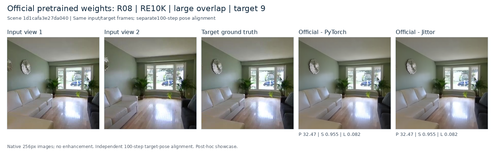
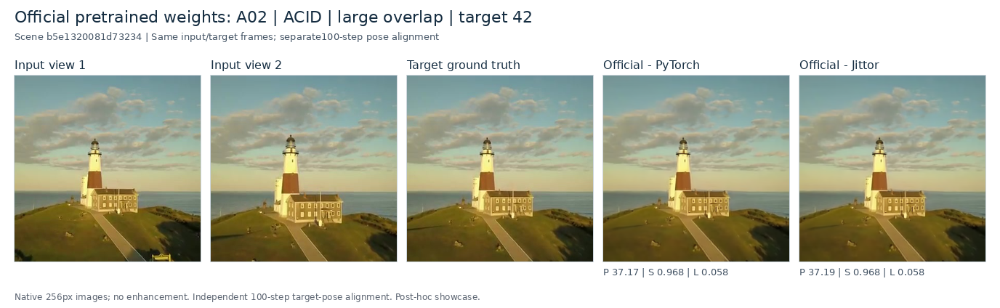

# NoPoSplat in Jittor

A Jittor implementation of **No Pose, No Problem: Surprisingly Simple 3D Gaussian Splats from Sparse Unposed Images** (ICLR 2025 Oral).

English · [Chinese](README_zh.md)

[Paper](https://proceedings.iclr.cc/paper_files/paper/2025/hash/857b34d81f0a8bfe3e18879dee3b5086-Abstract-Conference.html) · [Original project](https://github.com/cvg/NoPoSplat) · [Running guide](docs/RUNNING.md) · [Experiment details](docs/EXPERIMENTS.md)

NoPoSplat reconstructs a 3D Gaussian scene from a pair of images and renders novel views, using the images and camera intrinsics as input. This project brings its two-view, 256 × 256 pipeline to Jittor, from feature extraction and Gaussian prediction to differentiable rendering, training and evaluation.

The repository includes official-weight transfer on RealEstate10K and ACID, paired PyTorch/Jittor training runs, ablation results, training logs and visual comparisons.

## What's included

- A shared ViT encoder, cross-view attention, canonical Gaussian prediction and camera-intrinsics tokens.
- DPT prediction heads, the RGB shortcut, Gaussian covariance and spherical-harmonic attributes.
- A C ABI bridge that connects the original CUDA rasterisation kernels to Jittor's `jt.Function` interface.
- MSE + 0.05 VGG LPIPS, AdamW, learning-rate scheduling, gradient accumulation and resumable checkpoints.
- Data and checkpoint conversion tools, target-camera alignment, and PSNR/SSIM/LPIPS evaluation.

Jittor runs the model and training loop. A separate PyTorch environment handles checkpoint export and the reference experiments.

## Quick start

Use Linux, Python 3.10, a CUDA development toolkit with `nvcc`, and a C++ compiler. The example below uses an Ada GPU such as the RTX 4090 or 4090D, with CUDA 11.8 and compute capability 8.9.

```bash
git clone https://github.com/gutianheng/NoPoSplat-Jittor.git
cd NoPoSplat-Jittor
python3.10 -m venv .venv
source .venv/bin/activate
python -m pip install -e .

# Set this to your GPU's compute capability.
export NPS_CUDA_ARCH=89
bash scripts/build_rasterizer.sh

# Check the lightweight network and the native renderer.
python -m noposplat_jittor.cli smoke --config configs/tiny.yaml --output runs/tiny
python tools/check_native.py --output runs/native_check.json
```

The tiny configuration makes it quick to check tensor shapes and gradient flow before running the full model. For Blackwell GPUs, use CUDA 12.8 and follow the [Blackwell setup guide](docs/BLACKWELL.md), which covers the Jittor and cuDNN compatibility patches used in the experiments.

### Prepare data and weights

1. Follow the [original dataset instructions](https://github.com/cvg/NoPoSplat/blob/main/DATASETS.md) and download the [official checkpoints](https://huggingface.co/botaoye/NoPoSplat).
2. In the PyTorch environment, convert the checkpoints to NPZ, export LPIPS weights, and prepare the images and camera arrays.
3. For training, export the MASt3R initialisation. The RGB-shortcut ablation uses its own matching attribute-head initialisation.
4. Set the data and weight paths in the experiment configurations.

The [running guide](docs/RUNNING.md) provides the conversion commands, directory structure and configuration paths.

### Train and evaluate

After preparing the data and weights, run:

```bash
# Train the three configurations in Jittor.
bash scripts/train_reduced.sh jittor default
bash scripts/train_reduced.sh jittor no_intrinsics
bash scripts/train_reduced.sh jittor no_rgb

# Evaluate the transferred official weights.
bash scripts/test_official.sh re10k
bash scripts/test_official.sh acid
```

The training scripts run for 3,000 updates. To repeat the PyTorch comparison, use `torch` as the first argument in the reference environment. See the [running guide](docs/RUNNING.md) for checkpoint recovery, evaluation resume and custom paths.

## Measured results

Evaluation uses fixed subsets of **500 scenes per dataset**, with three target images per scene at **256 × 256** resolution. Each model uses **100 steps of target-camera optimisation against the target image** before scoring. Results are scene means, with FP32 computation. Higher PSNR and SSIM are better; lower LPIPS is better.

### Official-weight transfer

| Dataset | Framework | PSNR ↑ | SSIM ↑ | LPIPS ↓ |
|---|---|---:|---:|---:|
| RealEstate10K | PyTorch | 25.1335 | 0.841114 | 0.160214 |
| RealEstate10K | Jittor | 25.1312 | 0.841173 | 0.160151 |
| ACID | PyTorch | 25.8857 | 0.780518 | 0.194136 |
| ACID | Jittor | 25.8854 | 0.780618 | 0.194162 |

The transferred weights produce closely matched metrics in the two frameworks on both datasets.

### Paired training and ablations

Each configuration is trained on RealEstate10K for **3,000 updates**, starting from the matching MASt3R initialisation. Both frameworks use the same input sequence and random seed.

| Configuration | Framework | PSNR ↑ | SSIM ↑ | LPIPS ↓ |
|---|---|---:|---:|---:|
| Default | PyTorch | 21.5675 | 0.728219 | 0.245821 |
| Default | Jittor | 21.9102 | 0.737643 | 0.241951 |
| Without intrinsics embedding | PyTorch | 21.1486 | 0.702251 | 0.262351 |
| Without intrinsics embedding | Jittor | 21.0059 | 0.694324 | 0.261660 |
| Without RGB shortcut | PyTorch | 20.9745 | 0.682022 | 0.314568 |
| Without RGB shortcut | Jittor | 21.0484 | 0.681424 | 0.311519 |

Both frameworks show the same overall trend: the default model gives the best reconstruction quality, while removing the RGB shortcut has a particularly visible effect on texture and perceptual quality.

### Training curves


Each run uses a microbatch of four with two accumulation steps, giving an effective batch size of eight. Across 6,000 microbatches, each model processes 24,000 samples from 2,819 distinct training scenes. The [six training logs](results/train) contain the recorded losses for all configurations and both frameworks.

### Visual comparisons

**RealEstate10K: official weights, living-room scene.** From left to right: two input views, target image, PyTorch render and Jittor render.



**ACID: official weights, lighthouse scene.** The columns follow the same order.



**RealEstate10K: training and ablations, bedroom scene.** The lower row compares the two trained default models with the Jittor intrinsics and RGB-shortcut ablations.


Scene IDs, target frames and per-image metrics are available in the [example index](results/showcase_selection.csv). The [evaluation records](results/evaluation) contain the full results for the fixed subsets, and the [experiment guide](docs/EXPERIMENTS.md) explains the sampling and evaluation setup.

## Repository layout

```text
noposplat_jittor/     Network, renderer, data, losses and optimiser
native/              C ABI bridge for the CUDA rasteriser
vendor/              Rasteriser sources and upstream notices
configs/             Model configurations and fixed experiment indices
tools/               Conversion, training, evaluation and diagnostic tools
scripts/             Setup, build and experiment entry points
tests/               CPU tests for data, configuration and utilities
results/train/       Training CSV logs
results/evaluation/  Evaluation summaries and per-image/per-scene metrics
assets/              Training curves and visual comparisons
docs/                Setup instructions and experiment documentation
```

## Checks and experiment records

Run the CPU tests with:

```bash
python -m pip install numpy==1.26.4 Pillow==10.4.0 PyYAML==6.0.2 scipy==1.13.1 scikit-image==0.24.0
python -m unittest discover -s tests -p 'test_*.py'
```

On Windows, set `NPS_TEST_TMP` to a short writable path for the CPU tests. Use Linux for CUDA rendering and training.

The publication check recorded 71 passing tests and three skips for optional Torch archive fixtures. The [check record](results/release_cpu_validation.json), [executed source hashes](docs/executed_core_sha256.json) and [numerical diagnostics](docs/LIMITATIONS.md) provide more detail on the implementation and its verification.

## Acknowledgements and citation

This project builds on [NoPoSplat](https://github.com/cvg/NoPoSplat), CroCo/DUSt3R/DPT, the original differentiable Gaussian rasteriser, GLM and LPIPS. Component licences and attribution are collected in [LICENSE](LICENSE) and [THIRD_PARTY.md](THIRD_PARTY.md). Data and pretrained weights follow their publishers' terms.

The documentation layout was inspired by [Self-Blind-VSR-with-Jittor](https://github.com/Athena-Re/Self-Blind-VSR-with-Jittor).

```bibtex
@inproceedings{ye2025noposplat,
  title={No Pose, No Problem: Surprisingly Simple 3D Gaussian Splats from Sparse Unposed Images},
  author={Ye, Botao and Liu, Sifei and Xu, Haofei and Li, Xueting and Pollefeys, Marc and Yang, Ming-Hsuan and Peng, Songyou},
  booktitle={International Conference on Learning Representations},
  year={2025}
}
```
