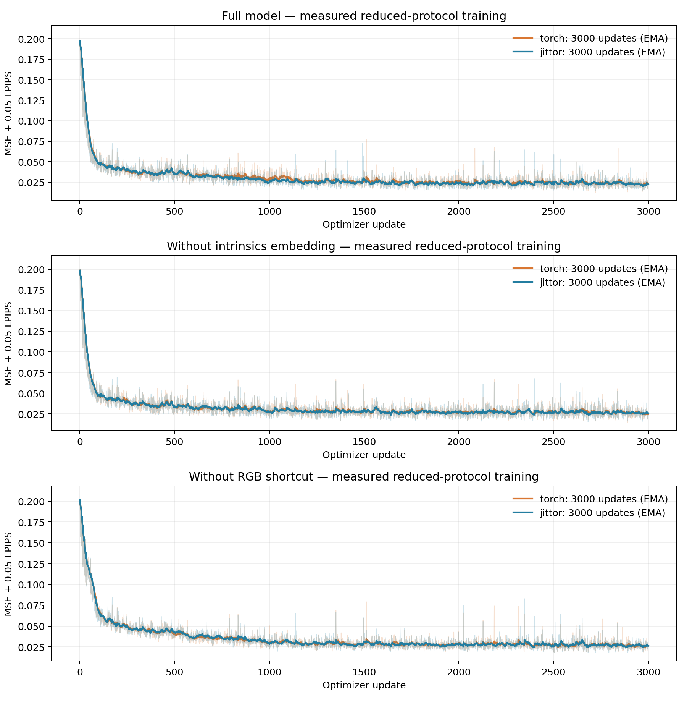
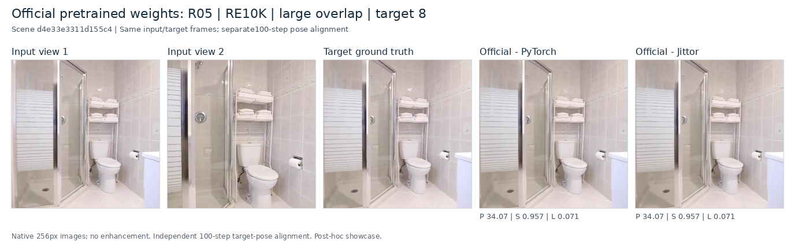
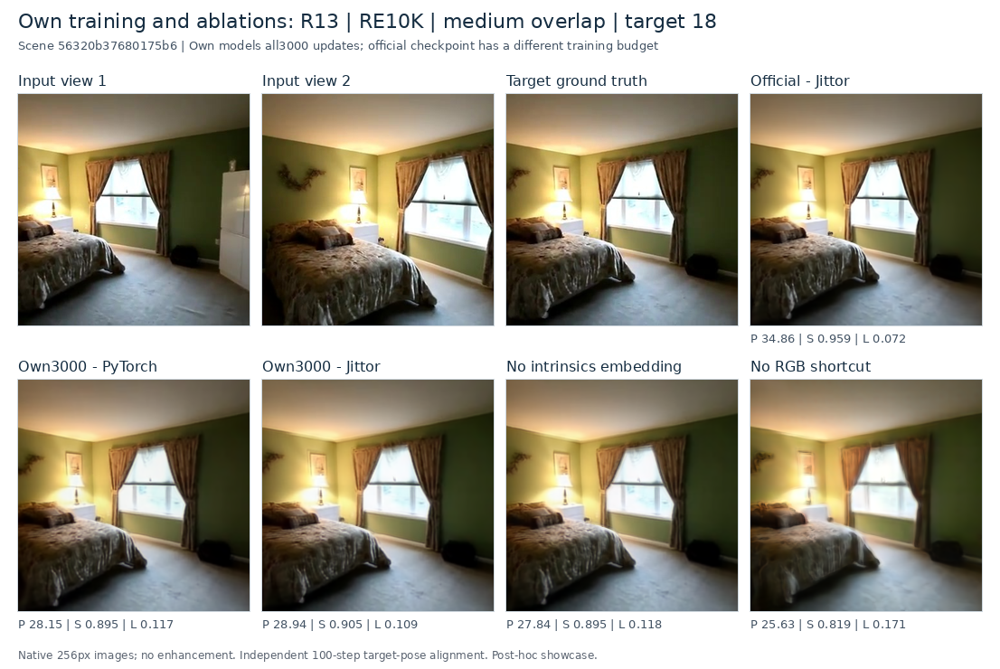

# NoPoSplat — Jittor migration and paired reproduction

**非官方研究迁移 · ICLR 2025 Oral · Gu Tianheng / 顾天恒**

[中文说明](README_zh.md) | English

[原论文](https://proceedings.iclr.cc/paper_files/paper/2025/hash/857b34d81f0a8bfe3e18879dee3b5086-Abstract-Conference.html) · [作者项目](https://github.com/cvg/NoPoSplat) · [环境与运行](docs/RUNNING.md) · [实验协议](docs/EXPERIMENTS.md) · [已知限制](docs/LIMITATIONS.md) · [许可与来源](THIRD_PARTY.md)

This repository implements the **default two-view, 256×256 NoPoSplat path in Jittor**, including the ViT/DPT network, Gaussian post-processing, a Jittor differentiable wrapper around the original CUDA rasterisation kernels, LPIPS/AdamW, training and target-pose-aligned NVS evaluation. PyTorch is used only for offline export and an **independent reference**, never to execute the Jittor model.

> **Status / 结果边界（2026-11-05）**: official-weight transfer, six independently trained 3000-update models, and ten fixed 500-scene evaluations were executed. **4/5 paired cases meet all predeclared aggregate tolerances. The default-trained PSNR difference fails its tolerance; 629/1129 historical strict gradient checks remain unresolved. This is not full-paper training, full-test-set evaluation, or a claim of complete numerical parity.**

## What is reproduced?

- Shared ViT encoder, two cross-view decoder branches, canonical Gaussian space and intrinsic token.
- Two DPT centre heads and two RGB-shortcut attribute heads; the default opacity, covariance, SH and camera conventions.
- Original pose-aware CUDA mathematical kernels behind a new ATen-free C ABI and `jt.Function` interface.
- MSE + 0.05 VGG LPIPS, AdamW parameter groups, clipping, scheduling, accumulation and resumable checkpoints.
- Official RE10K/ACID weights, controlled reduced RE10K training, target-camera optimisation and PSNR/SSIM/LPIPS.

## Repository layout

```text
noposplat_jittor/     Jittor network, renderer, data, losses and optimiser
native/              C ABI bridge (no ATen/libtorch)
vendor/              rasteriser sources and upstream notices
configs/             tiny/default configurations and fixed experiment indices
tools/               offline conversion, alignment, training and evaluation
scripts/             build / setup helpers
tests/               CPU contracts (not GPU numerical qualification)
results/train/       six measured training CSV logs
results/evaluation/  ten evaluation summaries and per-target/per-scene metrics
assets/              measured loss curves and qualitative examples
docs/                protocol, commands, provenance and limitations
```

## Quick start

Use Linux with a CUDA **development** toolkit (including `nvcc`), Python 3.10 and a supported GPU. The Python package alone does not compile the native renderer.

```bash
git clone https://github.com/gutianheng/NoPoSplat-Jittor.git
cd NoPoSplat-Jittor
python3.10 -m venv .venv
source .venv/bin/activate
python -m pip install -e .
# Choose the architecture of your actual GPU; 89 is Ada/RTX4090(D).
export NPS_CUDA_ARCH=89
bash scripts/build_rasterizer.sh
python -m noposplat_jittor.cli smoke --config configs/tiny.yaml --output runs/tiny
python tools/check_native.py --output runs/native_check.json
```

The tiny model only checks shape/finite-gradient plumbing. It is **not** the paper network and cannot load the paper checkpoint. **Blackwell/SM120 needs CUDA12.8 and additional Jittor/cuDNN9 adaptation**; do not use CUDA11.8 or an Ada binary cache. See [RUNNING](docs/RUNNING.md).

### Data and weights

Obtain licensed data and official checkpoints from the [author's dataset instructions](https://github.com/cvg/NoPoSplat/blob/main/DATASETS.md) and [official weights](https://huggingface.co/botaoye/NoPoSplat). Prepare the original reference checkout separately and convert serialised Torch files in the reference environment. The Jittor reader then consumes framework-neutral JPEG/camera NPZ files. Raw datasets, pretrained third-party weights and large optimiser checkpoints are not redistributed here.

See [complete conversion, training and evaluation commands](docs/RUNNING.md). The frozen subtest indices and declared exclusions are part of the experiment protocol, not the full official test set.

## Measured results

All rows below use fixed **500 scenes × 3 target images** per dataset, resolution256, FP32, and **100-step target-camera optimisation**. Own training is RE10K-only, one seed, 3000 updates. Official and own-trained weights have different training budgets. Metrics are scene means, PSNR/SSIM ↑ and LPIPS ↓.

| Experiment | Framework | PSNR | SSIM | LPIPS |
|---|---|---:|---:|---:|
| Official RE10K | torch | 25.1335 | 0.841114 | 0.160214 |
| Official RE10K | jittor | 25.1312 | 0.841173 | 0.160151 |
| Official ACID | torch | 25.8857 | 0.780518 | 0.194136 |
| Official ACID | jittor | 25.8854 | 0.780618 | 0.194162 |
| Default / RE10K / 3000 | torch | 21.5675 | 0.728219 | 0.245821 |
| Default / RE10K / 3000 | jittor | 21.9102 | 0.737643 | 0.241951 |
| No intrinsics embedding / 3000 | torch | 21.1486 | 0.702251 | 0.262351 |
| No intrinsics embedding / 3000 | jittor | 21.0059 | 0.694324 | 0.261660 |
| No RGB shortcut / 3000 | torch | 20.9745 | 0.682022 | 0.314568 |
| No RGB shortcut / 3000 | jittor | 21.0484 | 0.681424 | 0.311519 |

Official-weight tolerances are `0.1dB / 0.002 / 0.005`; own-training tolerances are `0.3dB / 0.01 / 0.01`. The default own-trained PSNR difference is **+0.342768dB** (Jittor−Torch), so the original0.3dB condition **fails**, even though the Jittor number is higher. Aggregate agreement does not imply per-scene or parameter-gradient agreement.

### Actual training curves



Three configurations × two frameworks, each3000 updates. Microbatch4 × accumulation2 = effective batch8. The6000 microbatch records are identical across frameworks/configurations; each model sees24000 sample occurrences and2819 distinct training scenes. A5000-update schedule was retained, but training stopped at3000; these logs must not be described as5000 completed updates.

### Qualitative examples





These are post-hoc presentation examples, selected for common absolute reconstruction quality rather than relative framework advantage or ablation degradation. Native256px outputs are not enhanced. The displayed target differs from both input frames. Every model independently follows the same target-pose optimisation procedure, so optimised cameras are not claimed element-wise identical. See [protocol details and limitations](docs/EXPERIMENTS.md).

## Validation and known issues

Run CPU contracts without Jittor or a GPU:

```bash
python -m pip install numpy==1.26.4 Pillow==10.4.0 PyYAML==6.0.2 scipy==1.13.1 scikit-image==0.24.0
python -m unittest discover -s tests -p 'test_*.py'
```

On Windows CPU-only checks, set `NPS_TEST_TMP` to a short writable path to avoid the legacy260-character path limit. The renderer and GPU training are qualified on Linux, not Windows.

CPU success, native finite-difference success, official-weight metric similarity and strict full-model gradient agreement are distinct evidence. See [LIMITATIONS](docs/LIMITATIONS.md) for outstanding checks and incomplete tasks. The opacity exponent-one boundary repair keeps the same forward algebra, preserves failed-run records, and retrains valid Jittor models; it does not replace nonfinite values or skip minibatches.

## Attribution and licensing

NoPoSplat, CroCo/DUSt3R/DPT, the Inria-derived rasteriser, GLM and LPIPS retain their own notices. **This repository is not uniformly MIT and must not be represented as unrestricted commercial software.** In particular, derived CroCo components carry CC BY-NC-SA4.0 conditions, and the rasteriser has its separate research licence. See [LICENSE](LICENSE) and [THIRD_PARTY](THIRD_PARTY.md). Dataset and weight terms remain those of their original publishers.

```bibtex
@inproceedings{ye2025noposplat,
  title={No Pose, No Problem: Surprisingly Simple 3D Gaussian Splats from Sparse Unposed Images},
  author={Ye, Botao and Liu, Sifei and Xu, Haofei and Li, Xueting and Pollefeys, Marc and Yang, Ming-Hsuan and Peng, Songyou},
  booktitle={International Conference on Learning Representations},
  year={2025}
}
```

The documentation organisation was informed by [Self-Blind-VSR-with-Jittor](https://github.com/Athena-Re/Self-Blind-VSR-with-Jittor); no VSR model code or experimental claims are imported from that project.

### Publication packaging checks

On2026-11-05 the curated public package discovered74 CPU tests:71 passed and3 optional Torch archive-fixture tests were explicitly skipped in the CPU-only publication interpreter. The26 neural/native mathematical source files match the executed server snapshot byte-for-byte. These checks do not claim a fresh GPU installation or eliminate historical full-model gradient failures. See `results/release_cpu_validation.json`.
