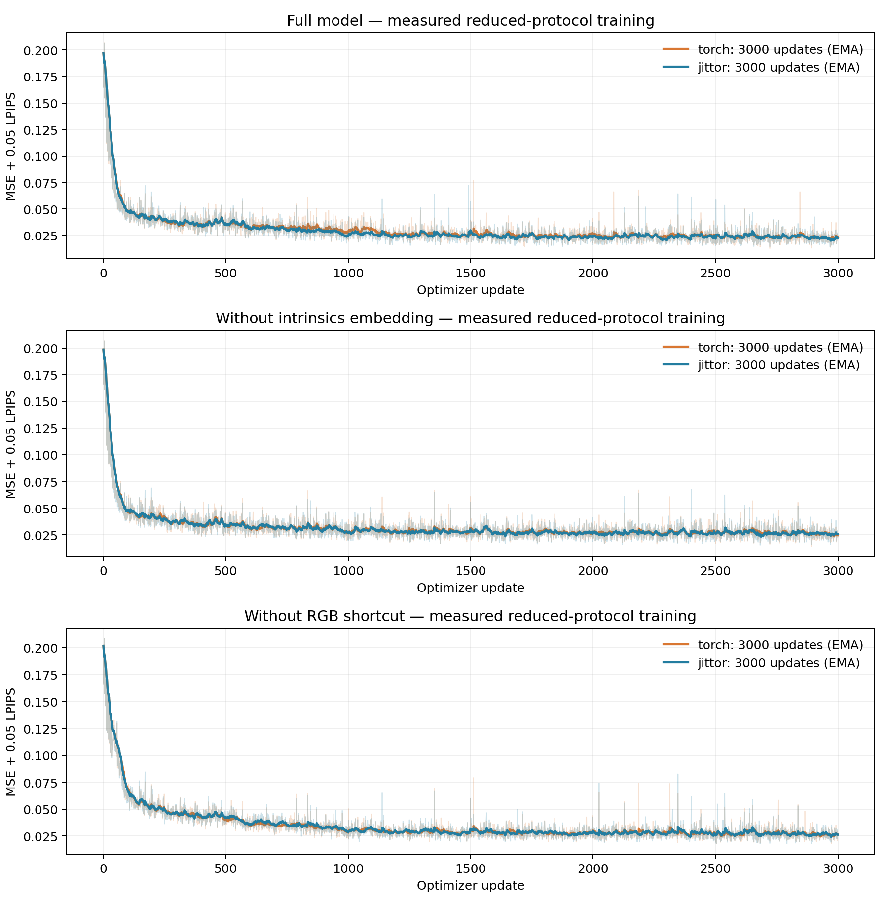
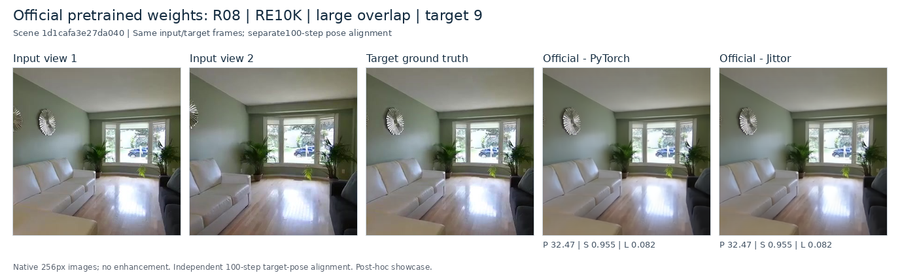
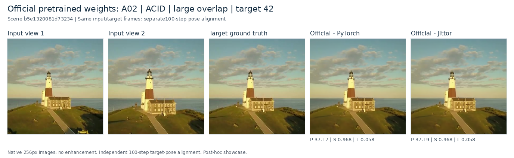
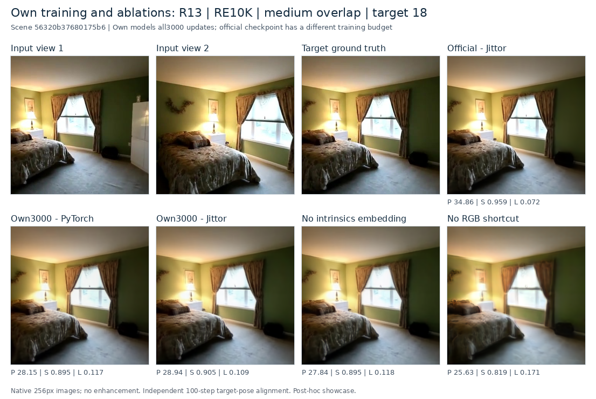

# NoPoSplat的Jittor实现

基于ICLR 2025 Oral论文《No Pose, No Problem: Surprisingly Simple 3D Gaussian Splats from Sparse Unposed Images》。

[English](README.md) · 中文

[论文](https://proceedings.iclr.cc/paper_files/paper/2025/hash/857b34d81f0a8bfe3e18879dee3b5086-Abstract-Conference.html) · [原项目](https://github.com/cvg/NoPoSplat) · [运行指南](docs/RUNNING.md) · [实验设置](docs/EXPERIMENTS.md)

NoPoSplat以两张图片和相机内参为输入，直接重建三维高斯场景，并渲染新的观察视角。这个项目用Jittor实现了它的双视图、256 × 256流程，涵盖特征提取、高斯预测、可微渲染、训练和评估。

仓库中提供了RealEstate10K和ACID上的官方权重迁移结果、PyTorch与Jittor的配对训练、消融实验，以及相应的日志和可视化。

## 主要功能

- 共享ViT编码器、跨视图注意力、规范空间高斯预测和相机内参token。
- DPT预测头、RGB捷径、高斯协方差与球谐属性。
- 通过C ABI桥接原CUDA光栅化内核，并接入Jittor的`jt.Function`求导接口。
- MSE + 0.05 VGG LPIPS、AdamW、学习率调度、梯度累积及断点续训。
- 数据与权重转换、目标相机对齐，以及PSNR、SSIM、LPIPS评估。

模型和训练循环由Jittor运行。另设PyTorch环境，负责权重导出和参考实验。

## 快速开始

使用Linux、Python 3.10、带`nvcc`的CUDA开发工具包及C++编译器。下面以RTX 4090或4090D等Ada显卡为例，采用CUDA 11.8，计算能力为8.9。

```bash
git clone https://github.com/gutianheng/NoPoSplat-Jittor.git
cd NoPoSplat-Jittor
python3.10 -m venv .venv
source .venv/bin/activate
python -m pip install -e .

# 按实际GPU的计算能力设置。
export NPS_CUDA_ARCH=89
bash scripts/build_rasterizer.sh

# 检查轻量网络和原生渲染器。
python -m noposplat_jittor.cli smoke --config configs/tiny.yaml --output runs/tiny
python tools/check_native.py --output runs/native_check.json
```

tiny配置便于先检查张量形状和梯度传递，再运行完整模型。Blackwell显卡使用CUDA 12.8，并按[适配指南](docs/BLACKWELL.md)配置实验中用到的Jittor和cuDNN兼容补丁。

### 准备数据和权重

1. 按[原项目的数据说明](https://github.com/cvg/NoPoSplat/blob/main/DATASETS.md)准备数据，并下载[官方权重](https://huggingface.co/botaoye/NoPoSplat)。
2. 在PyTorch环境中，将权重转为NPZ，导出LPIPS权重，并整理图像和相机数组。
3. 训练使用MASt3R初始化。去掉RGB捷径的配置需要导出与其属性预测头对应的初始化参数。
4. 在实验配置中填写数据和权重路径。

具体转换命令、目录结构和配置路径见[运行指南](docs/RUNNING.md)。

### 训练与评估

数据和权重准备好后，运行：

```bash
# 在Jittor中训练三种配置。
bash scripts/train_reduced.sh jittor default
bash scripts/train_reduced.sh jittor no_intrinsics
bash scripts/train_reduced.sh jittor no_rgb

# 评估迁移后的官方权重。
bash scripts/test_official.sh re10k
bash scripts/test_official.sh acid
```

训练脚本执行3,000次更新。在参考环境中将第一个参数改成`torch`，即可运行对应的PyTorch训练。断点恢复、评估续跑和自定义路径见[运行指南](docs/RUNNING.md)。

## 实验结果

每个数据集使用固定的**500个测试场景**，每个场景评估3张目标图，分辨率为**256 × 256**。评分前固定高斯，以真实目标图为参照优化目标相机**100步**。下表使用场景均值，计算精度为FP32。PSNR和SSIM越高越好，LPIPS越低越好。

### 官方权重迁移

| 数据集 | 框架 | PSNR ↑ | SSIM ↑ | LPIPS ↓ |
|---|---|---:|---:|---:|
| RealEstate10K | PyTorch | 25.1335 | 0.841114 | 0.160214 |
| RealEstate10K | Jittor | 25.1312 | 0.841173 | 0.160151 |
| ACID | PyTorch | 25.8857 | 0.780518 | 0.194136 |
| ACID | Jittor | 25.8854 | 0.780618 | 0.194162 |

官方权重迁移后，两框架在两个数据集上的三项指标都比较接近。

### 配对训练与消融

每种配置在RealEstate10K上训练**3,000次更新**，从对应的MASt3R初始化出发。两框架使用相同的输入序列和随机种子。

| 配置 | 框架 | PSNR ↑ | SSIM ↑ | LPIPS ↓ |
|---|---|---:|---:|---:|
| 默认模型 | PyTorch | 21.5675 | 0.728219 | 0.245821 |
| 默认模型 | Jittor | 21.9102 | 0.737643 | 0.241951 |
| 去掉内参嵌入 | PyTorch | 21.1486 | 0.702251 | 0.262351 |
| 去掉内参嵌入 | Jittor | 21.0059 | 0.694324 | 0.261660 |
| 去掉RGB捷径 | PyTorch | 20.9745 | 0.682022 | 0.314568 |
| 去掉RGB捷径 | Jittor | 21.0484 | 0.681424 | 0.311519 |

两框架呈现出一致的整体趋势：默认模型的重建质量最好，去掉RGB捷径对纹理和感知质量的影响更明显。

### 训练曲线



每次处理4组输入，累积2次梯度后更新，有效批量为8。每个模型共处理6,000个微批次、24,000次样本，涉及2,819个不同训练场景。全部配置和两框架的损失记录见[六份训练日志](results/train)。

### 图像对比

**RealEstate10K官方权重：客厅场景。** 从左到右依次是两张输入图、真实目标图、PyTorch渲染和Jittor渲染。



**ACID官方权重：灯塔场景。** 各列排列顺序与上图相同。



**RealEstate10K自行训练与消融：卧室场景。** 下排对比两框架训练的默认模型，以及Jittor中去掉内参嵌入和RGB捷径的结果。



场景编号、目标帧和逐图指标可在[样例索引](results/showcase_selection.csv)中查询。固定测试子集的完整结果见[评估记录](results/evaluation)，采样与评分流程见[实验说明](docs/EXPERIMENTS.md)。

## 项目结构

```text
noposplat_jittor/     网络、渲染、数据、损失与优化器
native/              CUDA光栅化器的C ABI桥接
vendor/              光栅化器源码与上游声明
configs/             模型配置和固定实验索引
tools/               转换、训练、评估与诊断工具
scripts/             环境、编译与实验入口
tests/               数据、配置及工具函数的CPU测试
results/train/       训练CSV日志
results/evaluation/  评估汇总与逐图、逐场景指标
assets/              训练曲线与图像对比
docs/                环境配置与实验文档
```

## 检查与实验记录

运行CPU测试：

```bash
python -m pip install numpy==1.26.4 Pillow==10.4.0 PyYAML==6.0.2 scipy==1.13.1 scikit-image==0.24.0
python -m unittest discover -s tests -p 'test_*.py'
```

Windows下可将`NPS_TEST_TMP`设置为较短的可写路径，运行CPU测试。CUDA渲染和训练使用Linux。

发布检查记录了71项通过和3项可选Torch档案测试跳过。更多实现细节和核对记录见[检查结果](results/release_cpu_validation.json)、[实际运行源码哈希](docs/executed_core_sha256.json)及[数值诊断](docs/LIMITATIONS.md)。

## 致谢与引用

项目基于[NoPoSplat](https://github.com/cvg/NoPoSplat)、CroCo/DUSt3R/DPT、原可微高斯光栅化器、GLM和LPIPS构建。各组件的许可与来源见[LICENSE](LICENSE)和[THIRD_PARTY.md](THIRD_PARTY.md)，数据及预训练权重遵循发布方的条款。

文档组织参考了[Self-Blind-VSR-with-Jittor](https://github.com/Athena-Re/Self-Blind-VSR-with-Jittor)。

```bibtex
@inproceedings{ye2025noposplat,
  title={No Pose, No Problem: Surprisingly Simple 3D Gaussian Splats from Sparse Unposed Images},
  author={Ye, Botao and Liu, Sifei and Xu, Haofei and Li, Xueting and Pollefeys, Marc and Yang, Ming-Hsuan and Peng, Songyou},
  booktitle={International Conference on Learning Representations},
  year={2025}
}
```
